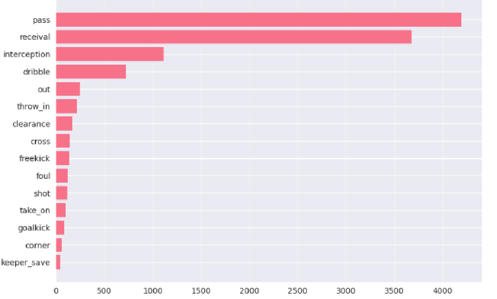
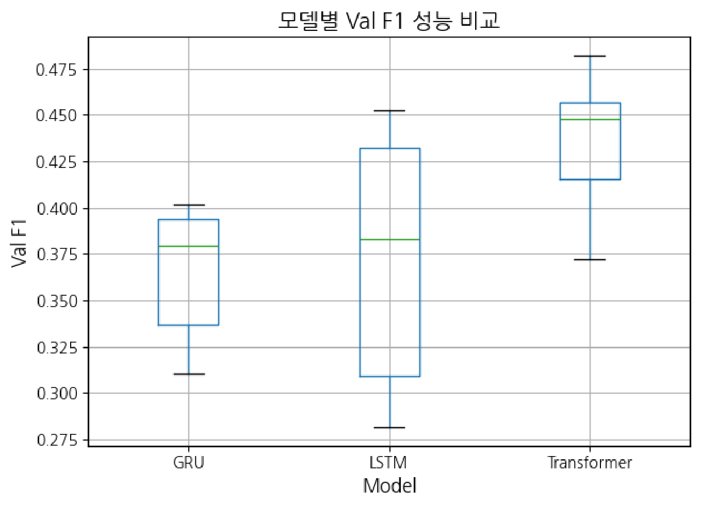
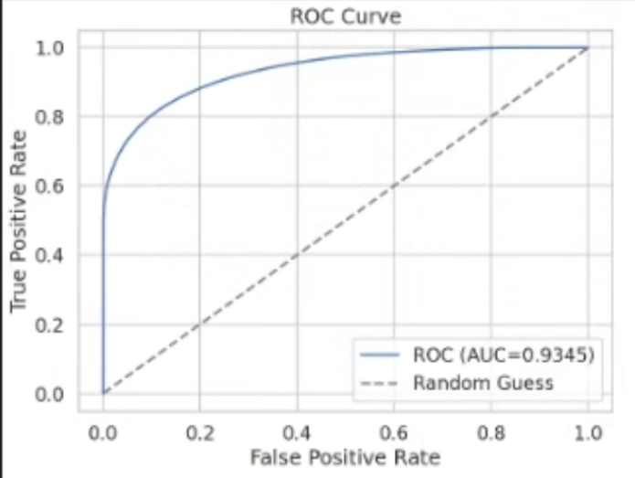
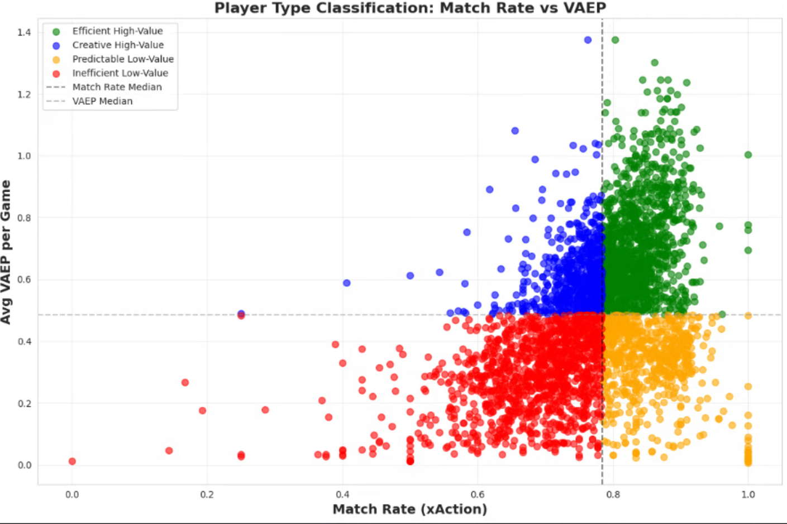
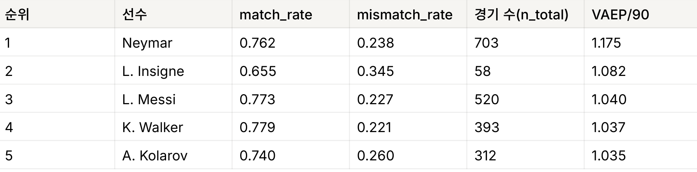
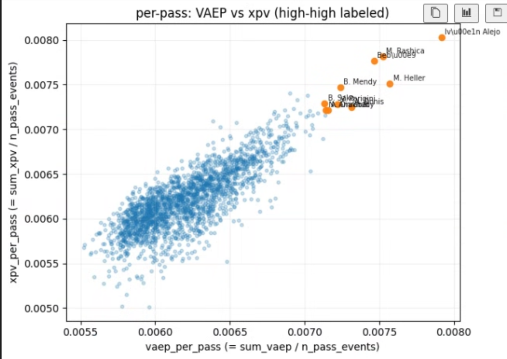

# Football Action Prediction and Value Analysis

축구 이벤트 시퀀스에서 다음 행동과 패스 성공 확률을 예측하고, 선수의 행동 선택이 만들어내는 가치를 VAEP와 함께 분석함.

- Wyscout 기반 Atomic SPADL 액션 **4,367,255건**, 1,941경기, 142개 팀, 3,031명 선수 데이터 사용.
- Transformer로 직전 4개 행동에서 **다음 행동의 유형과 상위 범주**를 예측함. 23개 행동 유형 분류에서 **Test Macro F1 0.5228** 기록, 무작위 Macro F1 약 0.0206.
- XGBoost로 **패스 성공 확률**을 추정함. Test AUC-ROC **0.9759**, Brier Score 0.0614 기록.

## Research Question

- 경기에서 직전 행동들을 관찰했을 때, 바로 다음에 패스, 슛, 드리블 등 어떤 행동이 발생할지 예측할 수 있는가?
- 패스의 거리, 각도와 직전 행동을 반영하면 평균 성공률만 사용할 때보다 성공 확률을 잘 추정할 수 있는가?
- 예측과 다른 행동을 자주 선택하면서도 높은 행동 가치를 기록하는 선수가 존재하는가?

## Method

### 1. Event Representation

- Wyscout 이벤트를 **Atomic SPADL**의 원자적 행동 단위로 변환하고, 공격 방향을 통일해 위치와 이동 정보를 비교함.
- 행동을 시간순으로 묶어 다음 이벤트를 예측하고, 패스 한 건의 성공 여부를 별도로 학습함.
- 학습/검증/테스트 데이터를 **70:15:15**로 분할해 모델 학습, 설정 선택과 최종 평가에 사용함.

### 2. Next Action Prediction

- **xAction**은 다음 액션의 구체적인 행동 유형(type)과 상위 행동 범주(category)를 예측하는 다중 과제 분류 모델임.
- GRU, LSTM, Transformer에 같은 입력 표현과 두 분류 헤드를 적용함. 최종 Transformer는 **직전 4개 액션**을 입력으로 사용함.
- 12×8 zone 위치 표현, 행동 간 시간 차이, 이동 변위와 정규화 위치를 입력에 포함함.
- type/category의 **Cross Entropy 손실을 가중 합산**하며, 세부 행동 유형을 예측하는 type 과제에 더 높은 비중을 부여함.
- 초기 Randomized Search 이후 모델별 TPE 탐색을 50회 수행하고, 일부 데이터에서 선별한 상위 5개 설정을 전체 데이터로 학습함.
- Validation Loss가 6 epoch 연속 개선되지 않으면 학습을 종료함. 최종 Transformer는 인코더 7개 층과 Feedforward 차원 1,536을 사용함.

### 3. Expected Pass Completion

- **xPass**는 주어진 패스가 성공할 확률을 추정하는 이진 분류 모델임.
- 패스 시작/종료 좌표, 거리, 각도, 전진성과 직전 이벤트 유형을 XGBoost 입력으로 사용함.
- Optuna TPE로 **Validation LogLoss를 최소화**하는 설정을 탐색하고, Early Stopping으로 반복 횟수를 정한 뒤 Train과 Validation을 합쳐 재학습함.
- AUC-ROC로 성공/실패의 구분 능력을 평가하고, LogLoss와 Brier Score로 예측 확률의 오차를 평가함.

### 4. Action Value and Player Aggregation

- **VAEP(Valuing Actions by Estimating Probabilities)**는 행동 전후의 득점 확률 증가와 실점 확률 감소를 합한 행동 가치임.
- **Match Rate**는 xAction의 예측과 실제 행동이 일치한 비율이며, Mismatch Rate는 1에서 Match Rate를 뺀 값임.
- 선수별 Match Rate와 경기당 평균 VAEP를 집계하고, 각 지표의 중앙값을 경계로 네 유형을 구분함.

## Experiments and Results

### 1. Action Distribution



- **pass, receival, interception이 전체 이벤트의 약 75%**를 차지함.
- Macro F1은 23개 행동 유형별 F1을 같은 비중으로 평균하므로, 드문 행동도 빈번한 패스와 동일한 비중으로 평가함.

### 2. Next Action Prediction Performance



| 모델        | 초기 탐색 Val F1 | 최종 Test Type Macro F1 |
| ----------- | ---------------: | ----------------------: |
| GRU         |            0.402 |                  0.4646 |
| LSTM        |            0.453 |                  0.4726 |
| Transformer |  **0.482** |        **0.5228** |

- 최종 점수는 **바로 다음 행동의 type을 분류한 성능**임. category 예측과 합산한 점수가 아니며, 0.5228을 전체 정답률 52.28%로 해석할 수 없음.
- 각 유형의 F1은 Precision과 Recall의 조화평균이며, Macro F1은 이를 23개 유형에 대해 평균한 값임. 빈번한 행동의 예측력이 높더라도 다른 유형의 F1이 낮으면 평균 점수가 제한됨.
- Transformer는 LSTM보다 **0.0502**, GRU보다 0.0582 높은 Test Type Macro F1을 기록함.
- 일부 데이터로 사전 평가한 Transformer의 0.4456은 전체 데이터 학습 후 **0.5228**로 증가함. Val F1은 초기 탐색, Test F1은 이후 TPE 탐색과 최종 학습에서 측정함.

### 3. Expected Pass Performance

| Test 지표      |               값 |
| -------------- | ---------------: |
| AUC-ROC        | **0.9759** |
| LogLoss        |           0.1997 |
| Brier Score    | **0.0614** |
| 패스 수        |          743,274 |
| 패스 성공 비율 |           0.8549 |



- 패스 성공 비율 **85.49%**의 불균형 환경에서 성공/실패 구분 능력과 확률 오차를 함께 평가함.
- 평균 성공률을 모든 패스에 동일하게 부여하는 이론적 Baseline의 Brier Score는 약 **0.1241**임. 모델의 0.0614는 이보다 약 50% 낮은 값임.
- Train/Test LogLoss는 **0.1735/0.1997**로, 테스트에서 예측 확률의 오차가 증가함.
- ROC 곡선의 AUC는 **0.9345**로 Test 평가값 0.9759와 차이가 있음. 동일 실행과 평가 분할에 해당하는지는 확인되지 않음.

### 4. Player Types by Match Rate and VAEP



- 가로축은 Match Rate, 세로축은 **경기당 평균 VAEP**이며, 점선은 각 지표의 중앙값임.

| 선수 유형             | Match Rate | 경기당 평균 VAEP | 관찰된 특성                                      |
| --------------------- | ---------- | ---------------- | ------------------------------------------------ |
| Efficient High-Value  | 높음       | 높음             | 예측 일치율과 경기당 기여가 모두 높음            |
| Creative High-Value   | 낮음       | 높음             | 예측과 다른 선택이 빈번하고 경기당 기여가 높음   |
| Predictable Low-Value | 높음       | 낮음             | 예측 일치율은 높고 경기당 기여는 상대적으로 낮음 |
| Inefficient Low-Value | 낮음       | 낮음             | 예측 일치율과 경기당 기여가 모두 상대적으로 낮음 |

- 선수들이 Match Rate 약 **0.8** 부근에 밀집하면서도 VAEP에는 차이를 보임.
- **Creative High-Value** 선수는 낮은 예측 일치율과 높은 VAEP를 함께 기록함. 예측과 다른 선택이 빈번한 선수도 높은 경기당 기여를 기록함.



- Neymar는 Match Rate **0.762**, VAEP/90 **1.175**, L. Messi는 각각 0.773, 1.040을 기록함.
- L. Insigne는 Match Rate **0.655**, Mismatch Rate 0.345에도 VAEP/90 1.082를 기록함.
- 선수 유형을 나누는 경기당 평균 VAEP와 **VAEP/90**은 분모가 다른 지표이며, 서로 구분해 비교함.

### 5. Per-Pass Value Comparison



- 가로축은 **패스당 VAEP**, 세로축은 패스당 xpv이며, 각 합계 값을 패스 이벤트 수로 나누어 계산함.
- 패스당 VAEP와 xpv가 함께 커지는 분포가 나타나며, 두 지표가 모두 높은 선수들을 주황색으로 표시함.

## Problems and Solutions

- **행동 클래스 불균형**

  - 이벤트가 패스와 수령/차단에 집중되어, 전체 정확도만으로 드문 행동의 예측력을 평가하기 어려움.
  - 행동 유형별 F1을 동일한 비중으로 평균하는 Macro F1으로 모델을 비교함.
- **공간 표현과 시퀀스 연속성**

  - 공격 방향이 다르면 같은 전개가 다른 좌표로 표현되고, 속성 결측으로 행동을 제거하면 시퀀스가 끊김.
  - 공격 방향을 통일하고 결측 속성을 기본값으로 대체하며, 물리적 범위를 벗어난 좌표와 시간 간격을 제한함.
- **높은 패스 성공률에 따른 평가 편향**

  - 성공 패스가 대부분이어서 성공만 예측해도 정확도가 높아짐.
  - LogLoss로 모델을 선택하고 AUC-ROC, Brier Score와 평균 성공률 Baseline을 함께 비교함.

## Limitations

- 트래킹 데이터가 없어 **수비 압박, 오프 더 볼 움직임과 공간 점유**를 직접 반영하지 못함.
- 패스 분석 대상은 **2017/18 시즌 상위 리그**이며, 다른 리그와 시즌에서의 일반화 성능은 추가 검증이 필요함.
- 클래스별 F1과 혼동행렬 분석이 남아 있어, **행동 유형별 오류 원인과 희귀 유형의 예측력**은 미확인임. 단순 행동 전이 모델과의 비교도 추가 과제임.
- Match Rate와 VAEP의 관계는 관찰된 연관성이며, 예측 불일치만으로 창의성이나 가치 창출의 원인을 확정할 수 없음.
- 선수 집계의 n_total 단위, xpv 산출 정의와 강조 선수 선정 기준은 미확정임.
- 다음 행동의 유형과 범주를 예측하며, 정확한 도착 위치와 다단계 전개 예측은 추가 과제임.

## How to Run

### Requirements

- Python 3.10 이상, 패키지 목록은 [requirements.txt](requirements.txt) 참고.
- 포함된 샘플은 **3경기, 6,613개 액션**이며, 전체 학습에는 원본 데이터가 별도로 필요함.

```bash
python -m pip install -r requirements.txt
python run_pipeline.py --mode sample
```

### Individual Stages

```bash
python run_pipeline.py --mode sample --stage prep
python run_pipeline.py --stage xaction
python run_pipeline.py --stage xpass
python run_pipeline.py --stage vaep
python run_pipeline.py --stage analysis
```

- 전체 데이터 실행은 변환된 [Atomic SPADL CSV](data/raw/)를 atomic_spadl_all_games.csv 이름으로 배치한 뒤 `python run_pipeline.py --mode full`로 수행함.
- `analysis`는 xAction과 VAEP 실행 결과를 사용하며, 기본 출력은 [results](results/)의 v1.0 하위 폴더에 저장됨.
- 기존 결과를 보존하려면 [config.yaml](config.yaml)을 복사해 version 값을 별도로 지정하고 `--config 설정파일경로`로 실행함.

### Implementation Scope

- 샘플 실행은 **소규모 모델 학습과 선수별 집계**를 수행하며, TPE 탐색과 Early Stopping은 포함하지 않음.
- xAction은 윈도우를 무작위 분할해 동일 경기의 표본이 학습/검증에 함께 포함될 수 있으며, 전체 실험의 테스트 성능을 재현하지 않음.
- 샘플 VAEP는 득점/실점 확률의 차를 사용함. 행동 전후 확률 변화와 실제 출전 시간에 따른 90분 보정은 별도 구현이 필요함.

## References

1. Decroos, T., Bransen, L., Van Haaren, J., Davis, J. (2019). [Actions Speak Louder than Goals: Valuing Player Actions in Soccer](https://tomdecroos.github.io/reports/kdd19_tomd.pdf). KDD, pp. 1851-1861.
2. Van Roy, M., Robberechts, P., Decroos, T., Davis, J. (2020). [Valuing On-the-Ball Actions in Soccer: A Critical Comparison of xT and VAEP](https://eos.cs.kuleuven.be/sites/eos.cs.kuleuven.be/files/xt-vs-vaep-aits.pdf). AAAI Workshop on Artificial Intelligence in Team Sports.
3. Pappalardo, L., Cintia, P., Rossi, A., et al. (2019). [A public data set of spatio-temporal match events in soccer competitions](https://pmc.ncbi.nlm.nih.gov/articles/PMC6817871/). Scientific Data, 6, 236.
